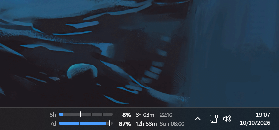
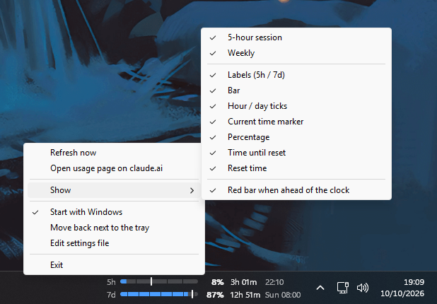
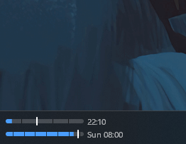

# Claude Taskbar Usage

A small Windows 11/10 widget that shows your Claude rate limits right in the taskbar, next to the tray icons.



- **5-hour session bar** and **weekly bar**, each with its percentage
- **Ticks**: hour marks on the 5-hour bar, local-midnight day marks on the weekly bar
- **Time marker** showing where "now" is in each window. A bar turns red when usage is ahead of the clock (or at 100%)
- **Countdown** to the reset plus the **reset time** (time only if it's today, weekday + time otherwise; 12/24h and weekday names follow your Windows regional settings)
- **Every element can be toggled** from the right-click menu, down to a minimal bars-only view
- Follows the light/dark taskbar theme and display scaling; re-attaches itself if Explorer restarts

| Right-click → Show | Minimal: bars + reset time only |
| --- | --- |
|  |  |

Inspired by [usage-monitor-for-claude](https://github.com/jens-duttke/usage-monitor-for-claude), and uses the same data source: the OAuth token Claude Code stores in `%USERPROFILE%\.claude\.credentials.json` (or `CLAUDE_CONFIG_DIR`) and `https://api.anthropic.com/api/oauth/usage`. The token is only ever sent to `api.anthropic.com`, in the Authorization header. The only other host it contacts is GitHub, for the [update check](#updates).

## Download

Get `ClaudeTaskbarUsage.exe` from the [latest release](https://github.com/rodrigohpalmeirim/claude-taskbar-usage/releases/latest). It's a single portable exe (under 0.5 MB, no installer, no runtime) that uses about 2–3 MB of private memory while running. Each release also lists the file's SHA-256.

The exe is not code-signed yet, so Windows SmartScreen may show "Windows protected your PC" the first time: click **More info → Run anyway**.

## Use

1. Make sure Claude Code is installed and logged in on Windows (`claude auth login`).
2. Run `ClaudeTaskbarUsage.exe` (put it somewhere permanent first, e.g. `%LOCALAPPDATA%\Programs\ClaudeTaskbarUsage\`, since autostart points at its location).
3. Right-click the widget → **Start with Windows** to launch it at login.

| Action | Effect |
| --- | --- |
| Hover | Tooltip with exact numbers, other weekly quotas (Sonnet, Opus, …) and the last update time |
| Click | Refresh now |
| Drag left/right | Move the widget along the taskbar (position is remembered) |
| Right-click | Menu: refresh, open claude.ai usage page, **Show** submenu (toggle each element), autostart, reset position, settings, exit |

On Windows 11 the taskbar app icons are drawn *above* other windows, so keep the widget in free space. If your taskbar is crowded, drag it, hide elements you don't need (right-click → **Show**), or reduce `bar_width`.

## Settings

`%APPDATA%\ClaudeTaskbarUsage\config.json` (right-click → **Edit settings file**). The `show_*` options are also in the right-click **Show** submenu and apply immediately; restart the widget after editing the file by hand. At least one row and one of bar / percentage / countdown / reset time always stay visible.

| Key | Default | Meaning |
| --- | --- | --- |
| `bar_width` | `110` | Width of each bar (in pixels at 100% scaling) |
| `show_session` | `true` | Show the 5-hour row |
| `show_weekly` | `true` | Show the weekly row (with only one row it is centered vertically) |
| `show_labels` | `true` | Show `5h` / `7d` in front of the bars |
| `show_bar` | `true` | Show the progress bars |
| `show_ticks` | `true` | Hour / day marks on the bars |
| `show_marker` | `true` | Current-time marker on the bars |
| `show_percent` | `true` | Percentage (`48%`) |
| `show_countdown` | `true` | Time until reset (`2h 13m`) |
| `show_reset_time` | `true` | Reset time (`14:59` / `Fri 21:00`) |
| `warn_when_outpacing` | `true` | Red bar when usage runs ahead of elapsed time |
| `theme` | `"auto"` | `auto`, `dark` (light text) or `light` (dark text) |
| `check_updates` | `true` | Check GitHub once a day for a new release (also in the right-click menu) |
| `poll_seconds` | `180` | API poll interval while you're at the computer (min 60) |
| `idle_poll_seconds` | `900` | Poll interval after 5 minutes without input |
| `offset` | `0` | Distance from the tray icons; set by dragging |

Polling also happens right after a reset, every 2 minutes while session usage is climbing, and backs off on errors / HTTP 429. If the token has expired, the widget runs `claude update` (at most every 30 minutes) to renew it, like usage-monitor-for-claude does.

A log of the current run is written to `%LOCALAPPDATA%\ClaudeTaskbarUsage\widget.log`.

## Updates

Once a day (and 30 seconds after start) the widget asks the GitHub API for the latest release of this repository. That request carries no account data, only a `ClaudeTaskbarUsage/<version>` User-Agent. When a newer version exists, a small dot appears in the widget's corner, the tooltip says so, and the right-click menu offers **Update to vX.Y.Z**. Clicking it:

1. downloads the new `ClaudeTaskbarUsage.exe` and its `.sha256` from the release,
2. checks the SHA-256 and refuses the file if it doesn't match,
3. moves the running exe aside, puts the new one in its place (same path, so **Start with Windows** keeps working) and restarts.

If the folder isn't writable (e.g. you put the exe in `Program Files`), it says so and opens the release page instead. Turn the check off with right-click → **Check for updates daily**, or `"check_updates": false`.

Command-line flags: `--demo` shows sample data without calling the API; `--overlay` draws the widget as a topmost window over the taskbar instead of docking into it (automatic fallback if docking fails).

## Build

Written in Rust against the raw Win32 API ([windows-sys](https://crates.io/crates/windows-sys)); the only other dependencies are serde / serde_json.

On Windows, `cargo build --release` is all you need. From Linux or macOS, cross-compile with mingw-w64 (this is also how releases are built):

```sh
sudo apt install mingw-w64                      # or: brew install mingw-w64
rustup target add x86_64-pc-windows-gnu
cargo build --release --target x86_64-pc-windows-gnu
# -> target/x86_64-pc-windows-gnu/release/ClaudeTaskbarUsage.exe
```

Tests: `cargo test` runs the parsing, time and settings tests on any OS (on Windows it also runs the time zone tests). To check the parser against a live response, save one to a file and run `USAGE_JSON=usage.json cargo test real_response -- --ignored --nocapture`.

### How it works

The widget is a layered child window of the taskbar (`Shell_TrayWnd`), the same technique TrafficMonitor uses. It's positioned relative to `TrayNotifyWnd`. Bars are rasterised with 4×4 supersampled anti-aliasing. Text is drawn by GDI into a coverage buffer and then alpha-blended, so it looks right on the translucent taskbar. HTTP goes through WinHTTP (the system TLS stack, certificate store and proxy settings) on a small background thread; the UI thread only paints, so it never blocks Explorer.

To keep memory low there is no GUI framework, async runtime or bundled TLS library, and nothing loads shell32 or COM (URLs and the settings file are opened through `explorer.exe`). The icon, manifest (per-monitor DPI awareness, Windows 8+ compatibility, which layered child windows need) and version info are embedded by `build.rs`.

Limitations: primary taskbar only; vertical taskbars aren't supported.

## Releasing

Bump `version` in `Cargo.toml`, commit, and push a matching tag. The release workflow builds the exe on GitHub Actions and publishes it with its checksum:

```sh
git tag v0.2.0 && git push origin v0.2.0
```

## License

MIT
